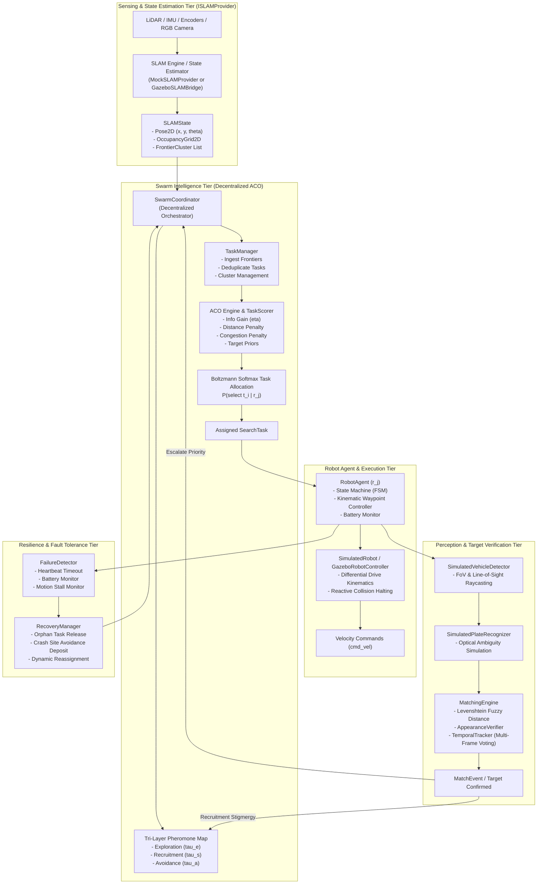
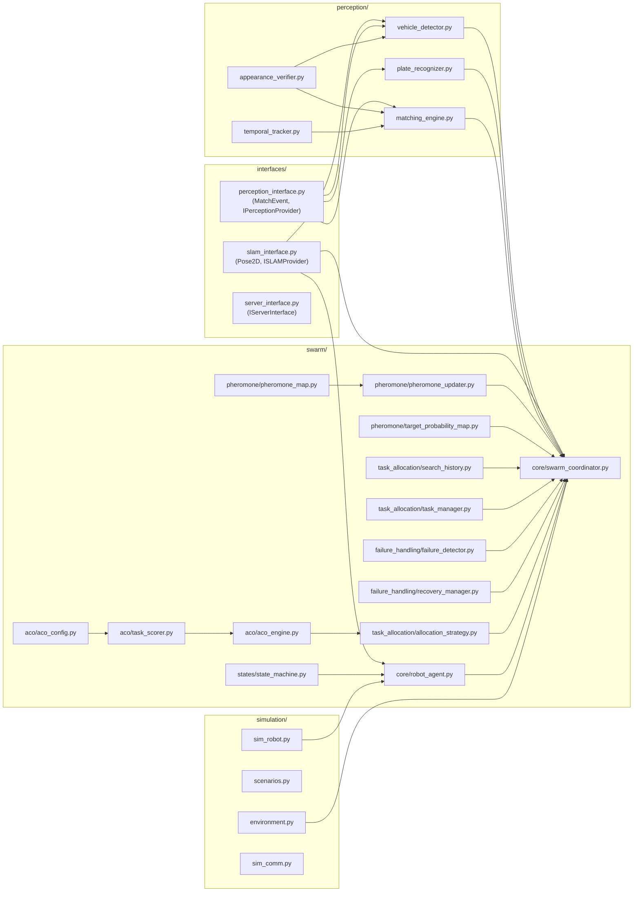
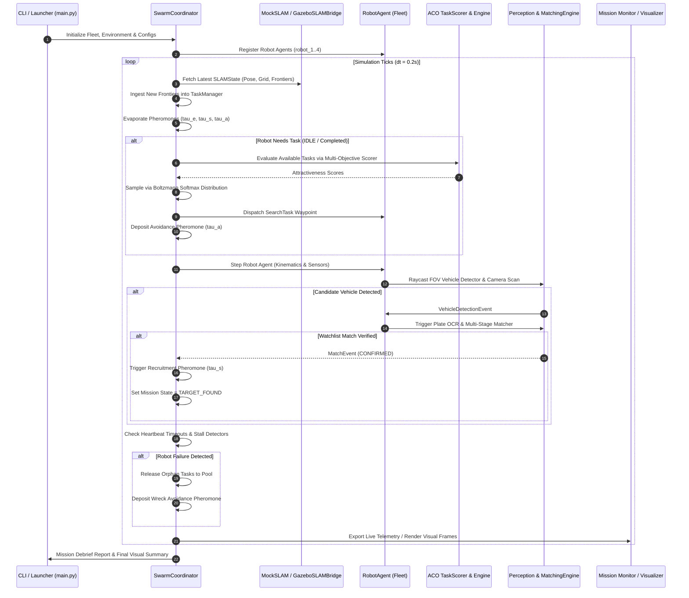
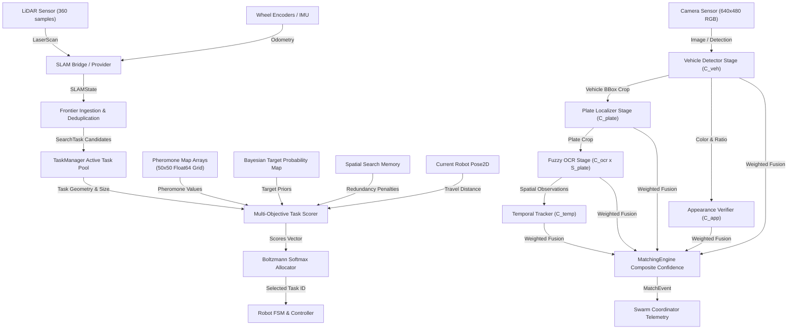
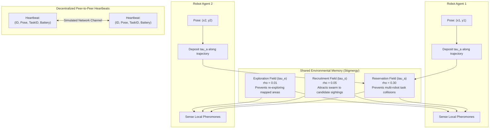
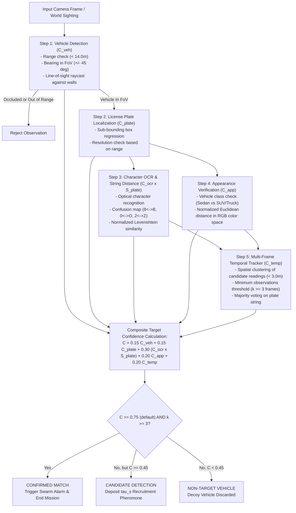
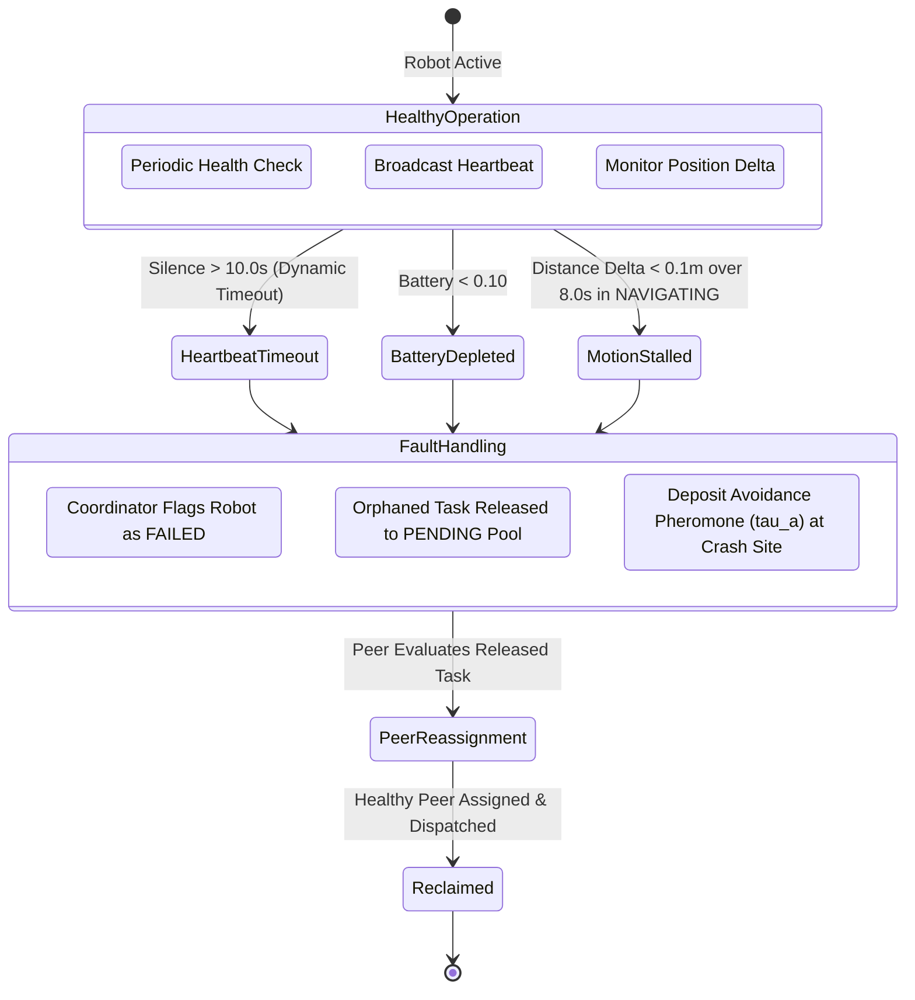
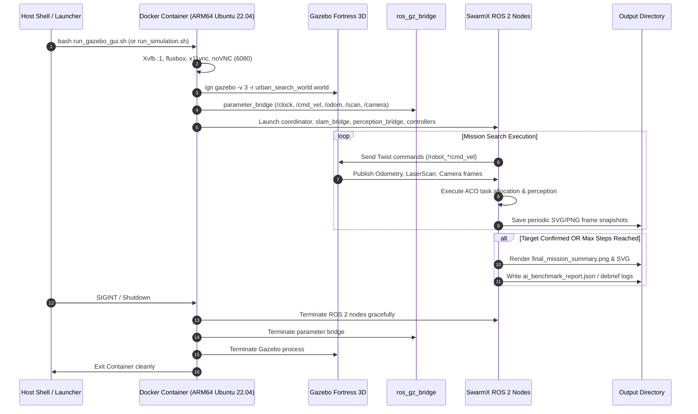

# SwarmX: System Architecture & Engineering Specification

## 1. Executive Architectural Overview

**SwarmX** is a decentralized, bio-inspired multi-robot coordination architecture engineered to solve outdoor urban search and target identification problems. The system integrates:
* **Decentralized Multi-Robot Task Allocation (MRTA)** powered by Ant Colony Optimization (ACO).
* **Multi-Layer Stigmergic Interaction** via continuous digital pheromone fields ($\tau_e, \tau_s, \tau_a$).
* **Abstracted SLAM & State Estimation** decoupled via the formal `ISLAMProvider` interface.
* **5-Stage Perception & Target Verification Pipeline** (vehicle classification, plate localization, fuzzy OCR, visual appearance verification, and temporal voting).
* **Decentralized Fault-Tolerance & Autonomous Reassignment** with stall and heartbeat failure monitors.
* **Dual Execution Infrastructure**: Pure-Python discrete kinematic simulation and containerized ROS 2 Humble / Gazebo Fortress 3D physics environment.

---

## 2. Team Subsystem Boundaries & Interface Contracts

To guarantee software decoupling and modular engineering:

| Subsystem | Engineers Responsible | Core Responsibilities | Interface Contracts |
| :--- | :--- | :--- | :--- |
| **Swarm Coordination & Task Allocation** | Mohammed & Ibrahim | ACO engine, task scoring, frontier selection, pheromone updates, decentralized consensus, failure recovery, dynamic re-assignment. | Consumes `ISLAMProvider`, produces task assignments and velocity goals. |
| **SLAM & State Estimation** | Saqr & Mahmoud | Sensor fusion (LiDAR, IMU, Wheel Encoders), pose estimation, 2D occupancy mapping, obstacle inflation, frontier extraction. | Implements `ISLAMProvider`, delivers `SLAMState`. |
| **Perception & Vision** | Unified Interface | Vehicle detection, plate cropping, synthetic/live OCR engine, watchlist fuzzy matching, appearance verification. | Implements `IPerceptionProvider`, delivers `MatchEvent`. |

> [!IMPORTANT]
> **Architectural Invariant**: The Swarm Coordination subsystem **never** implements SLAM internally and **never** relies on hardcoded internal maps. All spatial awareness flows exclusively through the standardized `ISLAMProvider` interface contract defined in [`interfaces/slam_interface.py`](file:///Users/aziz/Desktop/swarm_car_search/interfaces/slam_interface.py).

---

## 3. Required Architectural Diagrams (Mermaid Models)

### Diagram 1: Overall System Architecture

---

### Diagram 2: Module Dependency Graph

---

### Diagram 3: Runtime Execution Flow

---

### Diagram 4: Data-Flow Diagram

---

### Diagram 5: Robot-to-Robot Coordination & Stigmergy

---

### Diagram 6: Target Detection and Identification Pipeline

---

### Diagram 7: Failure Detection and Recovery Flow

---

### Diagram 8: Simulation Startup, Execution, and Teardown Flow

---

## 4. Major System Components Detail

### 4.1 Swarm Coordinator (`swarm/core/swarm_coordinator.py`)
* **What it does**: Central software hub responsible for synchronizing robots, advancing the tri-layer pheromone map, mediating inter-robot heartbeats, orchestrating task allocation, and recording mission-level telemetry.
* **Why it exists**: Serves as the high-level orchestration interface for the swarm while preserving local agent autonomy.
* **Inputs**: SLAM states, robot heartbeats, perception events.
* **Outputs**: Search task dispatches, pheromone updates, aggregated mission status.
* **Dependencies**: `TaskManager`, `ACOAllocationStrategy`, `PheromoneMap`, `PheromoneUpdater`, `FailureDetector`, `RecoveryManager`.
* **Verification Status**: **Implemented & Verified** across all test suites.

### 4.2 ACO Engine & Task Scorer (`swarm/aco/aco_engine.py`, `swarm/aco/task_scorer.py`)
* **What it does**: Evaluates candidate frontier clusters and target investigation tasks using a multi-objective scoring function and samples assignments using Boltzmann Softmax.
* **Why it exists**: Balances spatial exploration against target exploitation while preventing swarm collapse onto a single sector.
* **Mathematical Formulation**: Multi-factor synthesis detailed in [ALGORITHMS_AND_PARAMETERS.md](file:///Users/aziz/Desktop/swarm_car_search/docs/ALGORITHMS_AND_PARAMETERS.md).
* **Verification Status**: **Implemented & Verified** ([`tests/test_aco_engine.py`](file:///Users/aziz/Desktop/swarm_car_search/tests/test_aco_engine.py)).

### 4.3 Perception & Matching Engine (`perception/matching_engine.py`, `vehicle_detector.py`, `plate_recognizer.py`)
* **What it does**: Detects vehicles within camera FoV, extracts synthetic license plates, applies distance-based optical noise, verifies color/aspect ratio, tracks candidate observations over time, and calculates composite confidence against the target watchlist.
* **Verification Status**: **Implemented & Verified** ([`tests/test_perception_integration.py`](file:///Users/aziz/Desktop/swarm_car_search/tests/test_perception_integration.py), [`scripts/evaluate_ai_benchmarks.py`](file:///Users/aziz/Desktop/swarm_car_search/scripts/evaluate_ai_benchmarks.py)).

### 4.4 SLAM Bridge & Interface (`interfaces/slam_interface.py`, `ros2_ws/src/swarm_gazebo/swarm_gazebo/slam_bridge.py`)
* **What it does**: Subscribes to `/robot_*/scan` and `/robot_*/odom`, builds local 2D occupancy grids via raycasting, extracts unknown/free cell boundaries as frontier clusters, and delivers `SLAMState`.
* **Verification Status**: **Implemented & Verified in simulation** ([`tests/test_mock_slam.py`](file:///Users/aziz/Desktop/swarm_car_search/tests/test_mock_slam.py), `slam_providers/mock_slam_provider.py`).
